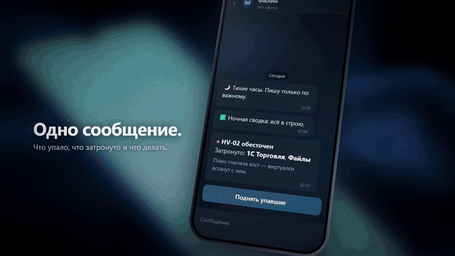
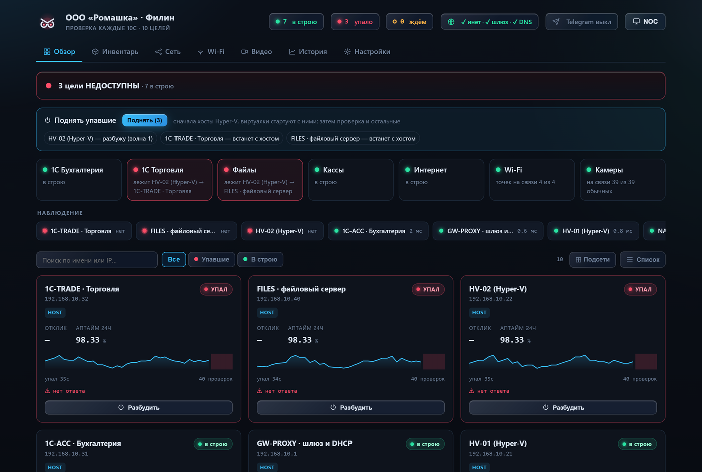
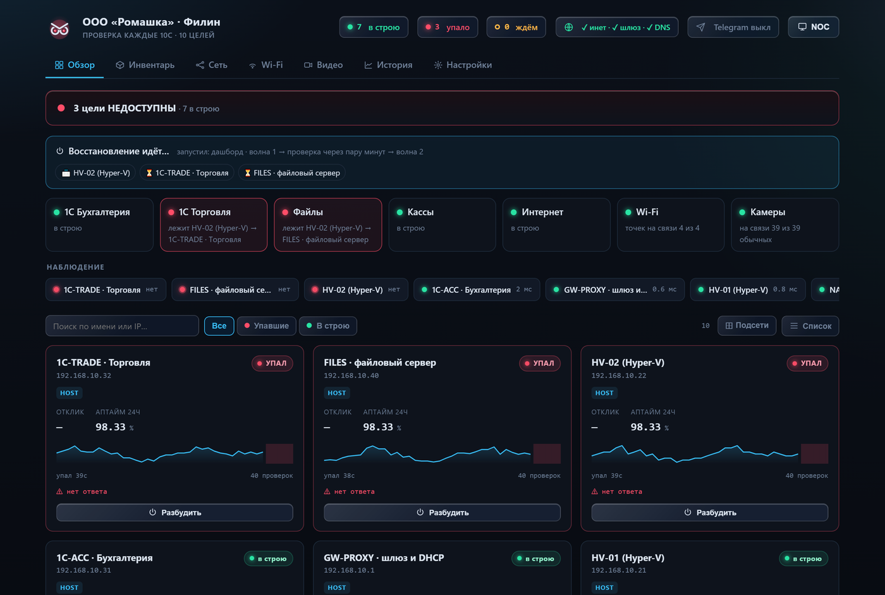
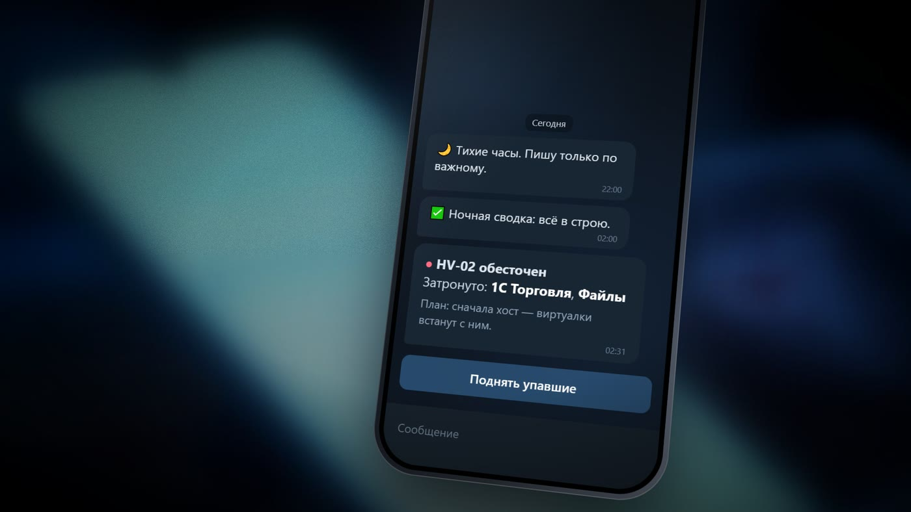
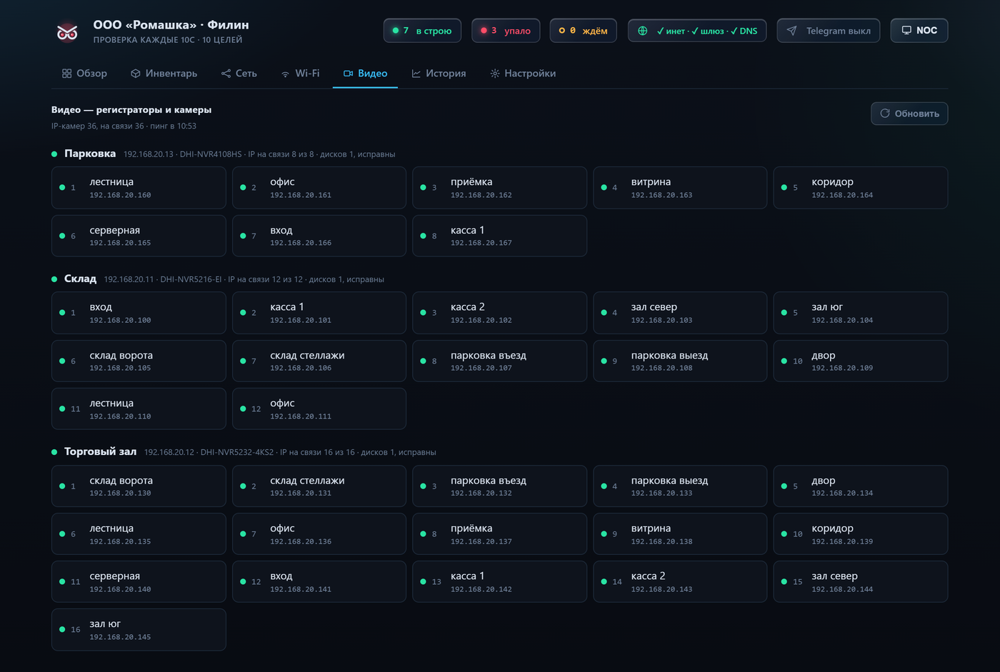
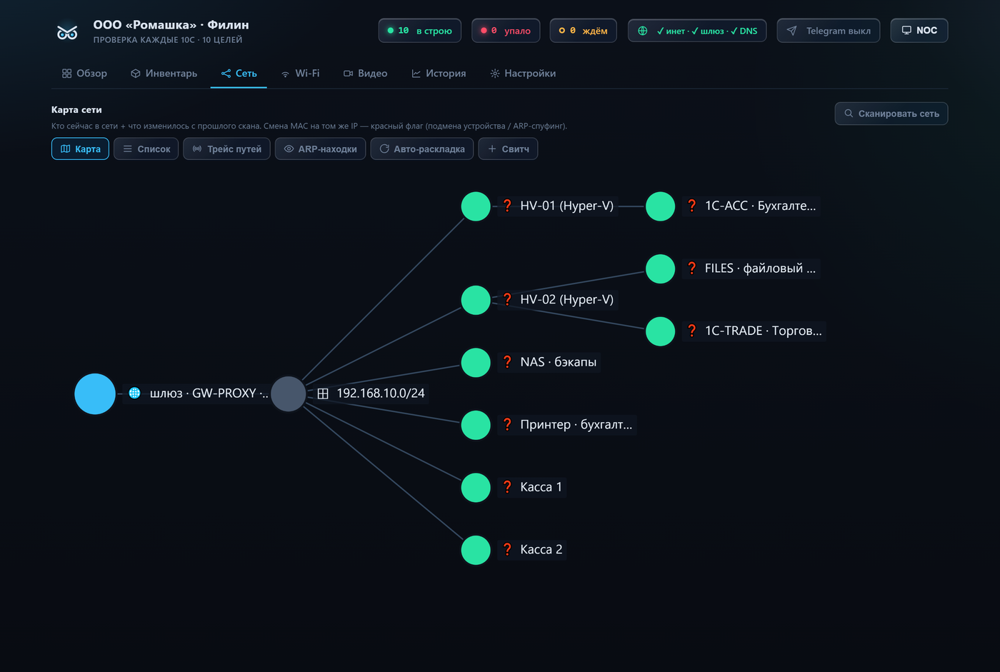

<p align="center">
  
</p>

<h1 align="center">Филин</h1>

<p align="center">
  <b>Мониторинг небольшого офиса, который не будит по пустякам и поднимает серверы из Telegram.</b>
</p>

<p align="center">
  
  
  
  
  
</p>

<p align="center">
  
</p>

Один `.exe` на офисном ПК: следит за серверами, 1С, кассами, интернетом, Wi-Fi и камерами, пишет в Telegram только то, на что нужно реагировать, и умеет сам вернуть офис к жизни после отключения света. На Python ставить нечего: только стандартная библиотека, ни одного пакета из pip.

**Скачать:** готовый `ServerSignalDesk-v0.58.1.exe` — в [релизах](https://github.com/N1kollo/filin-monitor/releases/latest).
Там же полный ролик «Ночная смена» (61 с).

**Попробовать без своей сети:**

```
python demo/demo.py      # выдуманный офис «Ромашка», симулированная сеть → http://127.0.0.1:8090
```

---

## Как это выглядит

**Авария: одна причина вместо пачки тревог.** Упал хост Hyper-V — плитки сервисов говорят, что именно не работает и почему, а сверху готов план подъёма.



**Подъём волнами.** Сначала хосты по Wake-on-LAN, виртуалки встают с ними, потом проверка и всё остальное.



<table>
<tr>
<td width="50%"><b>Telegram:</b> одно сообщение — что упало, что затронуто, что делать. И кнопка.<br><br></td>
<td width="50%"><b>Камеры по объектам:</b> какая где и кто на связи, регистраторы только на чтение.<br><br></td>
</tr>
<tr>
<td colspan="2"><b>Сеть:</b> карта, шлюз, чужой DHCP, конфликт IP, трасса до упавшего хоста.<br><br></td>
</tr>
</table>

Все данные на скриншотах — выдуманный демо-офис.

## Откуда он взялся

Писался под живой офис: пять подсетей на одном коммутаторе, три хоста Hyper-V с виртуалками 1С, почти сотня камер на шести регистраторах, Wi-Fi от торгового центра, который на ночь обесточивает точки. Готовые системы ставились и снимались: Uptime Kuma умеет «жив / не жив», Zabbix умеет всё, но месяц настройки — и всё равно шумит.

Боевая проверка случилась сама: в здании отключили электричество, на месте никого не было. Серверы подняли из Telegram, по одному, по памяти. После этого монитор научился делать это сам — волнами, в правильном порядке.

## Что умеет

| | |
|---|---|
| **Сервисы, а не хосты** | «1С Торговля не работает — лежит HV-02», а не «192.168.10.32 не отвечает на 445». Причина ищется вверх по цепочке «виртуалка → хост Hyper-V». |
| **Подъём после света** | «Поднять упавшие»: сначала хосты Hyper-V по Wake-on-LAN, виртуалки встают с ними сами, затем проверка и остальное. Из Telegram или дашборда. |
| **Тишина по делу** | Выдержка до алерта, тихие часы для некритичного, окно ночного отключения точек, защита от шторма, эскалация критичного. На живом офисе: 18 сообщений за ночь → 0, без потери важного. |
| **Бот на кнопках** | Статус, упавшие, карточка хоста, «разбудить», обслуживание, фильтр алертов, обновление — всё кнопками, экран редактируется на месте. |
| **Видео** | Регистраторы Dahua только на чтение: какая камера на каком объекте, кто на связи, стоп-кадр по клику (пароли до браузера не доходят). Ровно одна попытка входа — у Dahua блокировка после ~5. |
| **Сеть** | WAN по трём ногам (шлюз / канал / DNS), чужой DHCP, конфликт IP, пассивное «ухо» SSDP/mDNS, трасса до упавшего хоста, деградация задержки до падения. |
| **Обновление с откатом** | Новый exe кладётся в «Загрузки» → кнопка в боте. Пробный запуск, текущая версия в `backup\`, замена, перезапуск. Не прошла первый цикл за 150 с — возвращается старая, в Telegram приходит, почему. |

## Как устроено

```
monitor.py            точка входа
ssd/                  29 модулей, стандартная библиотека Python 3.8+
  core                пути, логи, конфиг
  checks, livestate   проверки и состояние хостов
  alerting            emit() — единственная дверь для любого алерта
  policy, holddown    тихие часы, эскалация, обслуживание, выдержка
  outbox              алерт на мёртвом канале повторяется, а не теряется
  services, recovery  сервисы поверх хостов, подъём волнами
  bot, telegram, web  бот, транспорт, HTTP + REST API, дашборд
  wifi, unifi         эфир: evil-twin, чужие точки, UniFi как сенсор
  dahua, video        регистраторы и камеры
  update              самообновление с откатом
dashboard.html        интерфейс, без сборки
tests/                228 known-answer тестов
demo/                 тот же монитор на выдуманном офисе
```

Сборка — `build-exe.bat`: PyInstaller, один файл, и только при зелёных тестах.

## Решения, которые стоит знать

- **Один путь для алерта.** Каждое сообщение идёт через `emit(kind, …)`: фильтр типа → глушение хоста → окно обслуживания. Когда-то тип угадывался по имени функции-отправителя — переименовали функцию, и глушение WAN молча перестало работать.
- **Состояние переживает рестарт.** Что уже сообщено, что подтверждено, что эскалировано — в снимке и журнале. Без этого каждый перезапуск повторял 35 сообщений о том, что и так висит.
- **Тесты ловили баги, жившие месяцами.** На русской Windows `ping` мерил время запуска процесса, а не ответ сети (шлюз «54 мс» вместо 1 мс). Деградация не снималась 14 часов. Две копии монитора делили один порт.
- **Монолит разобран скриптом, а не руками.** 7 680 строк → 29 модулей: у каждого имени один модуль-владелец, обращения между модулями — `модуль.имя` во время вызова. Ни один тест не менялся.
- **Сторож за сторожем.** Монитор пингует healthchecks.io; если он умрёт, тревога придёт оттуда. Проверено остановкой, а не тестовым сигналом — и это нашло дыру: дефолтное расписание проверки поднимало тревогу через сутки.

## Запуск

- **Попробовать:** `python demo/demo.py` — ничего не настраивая и не трогая вашу сеть.
- **Настоящий офис:** `python monitor.py` → <http://localhost:8081> → всё в интерфейсе. Или `build-exe.bat` и `install-service.bat` на офисном ПК.
- Руководство — [docs/USAGE.md](docs/USAGE.md): Telegram, служба, камеры, обновление, внешний сторож.
- Описание проекта — [docs/PROJECT.md](docs/PROJECT.md), безопасность — [SECURITY.md](SECURITY.md), REST API — [API.md](API.md), история — [CHANGELOG.md](CHANGELOG.md).

Интерфейс и сообщения — на русском.

## Лицензия

MIT — см. [LICENSE](LICENSE). Встроенные в `dashboard.html` библиотеки — [THIRD-PARTY.md](THIRD-PARTY.md).
